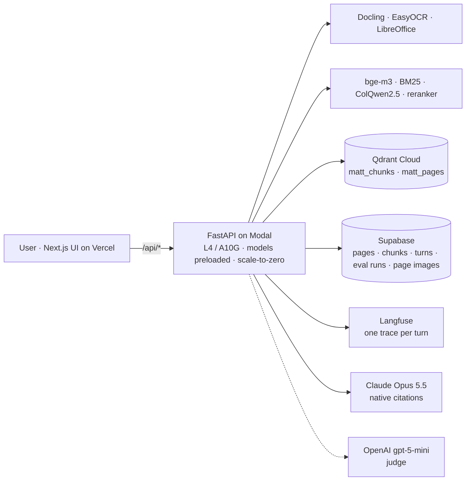

# Matt: multimodal RAG over document pages

Ingest documents, retrieve ranked page evidence with document and page references, answer with citations, and show
the evidence, the evaluation results and the latency. Built for the ViDoRe V3 take-home; the same pipeline serves
uploads in a Playground.

Hosted end to end: query API on Modal (GPU, scale-to-zero), vectors in Qdrant Cloud, metadata and page images in
Supabase, traces in Langfuse, answers from Claude Opus 5.5, UI in Next.js. Nothing is stored on a laptop.

Baseline: hybrid text RAG (bge-m3 dense + BM25, RRF). Improvement: the same with a cross-encoder reranker over the
top 20 pages. The two are judged on answers, not ranks: the same 30 benchmark queries through both, graded by a
deterministic rubric and by an LLM judge (section 6).

1. [Requirements](#1-requirements)
2. [Dataset](#2-dataset)
3. [Ingestion and chunking](#3-ingestion-and-chunking)
4. [Document structure: tables, figures, boundaries](#4-document-structure-tables-figures-boundaries)
5. [Retrieval](#5-retrieval)
6. [Evaluation](#6-evaluation)
7. [System design](#7-system-design)
8. [Latency and cost: measured, then estimated](#8-latency-and-cost-measured-then-estimated)
9. [Implemented vs proposed](#9-implemented-vs-proposed)
10. [Human-robot interaction](#10-human-robot-interaction)
11. [Running it](#11-running-it)
12. [Status and pending](#12-status-and-pending)

## 1. Requirements

**Functional**

| # | Requirement | Where |
|---|---|---|
| F1 | Ingest PDF, PPTX, DOCX, images, Markdown and text; detect type from bytes | `pipeline/routing.py`, `pipeline/parsing.py` |
| F2 | Parse layout, tables, figures and OCR; keep bounding boxes and a page image per page | Docling + EasyOCR, LibreOffice for office files |
| F3 | Index text (dense + sparse) and page images (ColQwen multivectors) | Qdrant `matt_chunks`, `matt_pages` |
| F4 | Retrieve ranked page evidence with document and page references | `pipeline/retrieval.py`, every answer's `[n]` citations |
| F5 | Answer from the evidence only, with citations; decline when the pages lack the answer | `pipeline/answer.py`, Claude native citations |
| F6 | Preload the ViDoRe subset; chat over it | Dataset tab |
| F7 | Inspect evidence: chunk, page image, region, scores, every candidate list; compare runs side by side; delete a conversation | Evidence tab, explain view |
| F8 | Compare a baseline and an improvement on the same question, with their answer-eval headline | ViDoRe Pipeline tab |
| F9 | Answer evals against the reference answers through two pipelines (deterministic checks, LLM judge); retrieval diagnostics against the page labels | Answer Evals, Retrieval Evals tabs |
| F10 | Latency, cost and GPU observability per turn and per stage | Observability tab, Langfuse |
| F11 | Keys entered in the UI, tested live, never in the browser | Settings tab |

**Non-functional**

| # | Requirement | How it is met |
|---|---|---|
| N1 | Hosted only, no local state | Modal + Qdrant Cloud + Supabase + Langfuse; the laptop runs only the dev UI |
| N2 | Time to result under about 10 s warm; first token within a few seconds | streaming answer, retrieval 0.3 s (baseline) to 2.3 s (with reranker); measured in section 8 |
| N3 | Cost control | scale-to-zero after 10 min idle; one flag keeps a container warm for demos |
| N4 | Reproducible evaluation | deterministic rubric, frozen judge, seeded benchmark sample (the same 30 queries for every config), stored runs with per-query detail |
| N5 | Idempotent, resumable ingestion | per-document ids; the 415-page build skips pages already present |
| N6 | Thread-safe tracing while streaming | explicit parent/child Langfuse observations, no ambient context |
| N7 | Secrets server-side | Modal secret; optional bring-your-own Anthropic key in an encrypted httpOnly cookie |
| N8 | Honest reporting | measured and estimated numbers kept in separate tables |
| N9 | Expected data volume | today 415 pages, 1,077 chunks, about 324k ColQwen vectors (170 MB); designed for a few thousand pages per workspace: pooled-vector gate before MaxSim, multivectors on disk; beyond that, one Qdrant collection per workspace (section 7) |
| N10 | Concurrency | 8 concurrent requests per Modal container (`@modal.concurrent(max_inputs=8)`), containers scale from 0; one GPU forward pass at a time per container, answers stream in parallel; eval runs use 4 workers |
| N11 | Reliability | an ingest step that fails marks the job row and the UI; a chat error streams as an event and marks the trace; a page image that fails to load degrades that page to text only; Claude refusals and token-limit stops are reported, with the server-side fallback for provider outages; known gap: a container scaled to zero mid-ingest loses that job |

Not covered, and worth stating to a reviewer: no authentication on the hosted dashboard, no rate limiting, no
retention policy for uploads (a conversation and everything indexed for it can be deleted by hand from the Evidence
tab), no accessibility pass on the UI.

## 2. Dataset

**Why ViDoRe V3.** The task is page-level evidence retrieval over visually rich documents, and ViDoRe is the
reference benchmark for exactly that (the ColPali line of work). Among its versions, V3 is the only one that ships
everything the two evaluations need: graded page labels per query, bounding boxes, the OCR text the authors used,
reference answers, and six query languages. V2 (also downloaded, three domains) has page labels but no reference
answers, so answer quality could not be scored against it. General document QA sets lack page-level relevance labels.

**The ten datasets.** Computer science, energy, finance (English), finance (French), HR, industrial, pharmaceuticals and
physics are public; nuclear-energy regulation and telecom standards are private. We took computer science, and within
it one of its two textbooks, *Introduction to Python Programming*.

**Why this one.** Three reasons. The questions need tables, code blocks and figures (47 of the 79 need a table), which
is exactly where retrieval decides the answer, so an improvement can be measured rather than assumed. A reviewer can judge the answers without domain expertise, which is not true of pharmaceuticals or nuclear
regulation. And at 415 pages it is the smaller of the two textbooks (the other is 945), large enough that retrieval
decides most failures and small enough to build and evaluate for a few dollars. Its 79 English queries also cover
every query type in the benchmark: boolean, numerical, extractive, enumerative, compare-contrast, multi-hop, open-ended.

**Sizes.**

| Level | Documents | Pages | Queries |
|---|---|---|---|
| ViDoRe V3, full benchmark | 10 datasets (8 public, 2 private) | about 26,000 | 3,099 human-verified, each in 6 languages |
| Computer-science split (public) | 2 textbooks | 1,360 | 1,290 (215 English) |
| **This subset: *Introduction to Python Programming*** | 1 textbook | 415 | 79 English (474 across 6 languages), 2,280 graded labels over 205 pages |

Benchmark totals from the [ViDoRe V3 release post](https://huggingface.co/blog/QuentinJG/introducing-vidore-v3) and the
[paper](https://aclanthology.org/2026.acl-long.755/); split and subset counts from the downloaded data.

One document is a deliberate demo-size choice: it keeps the index build under ten minutes on one GPU and the two
answer evals under ten dollars, while still being large enough that retrieval, not the model, decides most failures.
Every script takes a split or a domain as its argument; nothing is specific to this book.

## 3. Ingestion and chunking

`route → parse → chunk → embed text → embed pages → index`, one job per upload, progress streamed to the UI.

**Chunking strategy.** The page is the evidence unit; chunks exist to give the text embedders the right input size.

- Paragraphs are packed to about 300 words without splitting a paragraph.
- A table is one chunk. A long table is split by rows with the header row repeated in every part.
- A figure chunk is its caption. The figure's content is covered by the page-image embedding, not by text.
- The heading path (chapter › section) is prepended for embedding only, so a chunk about "tail(n)" also carries
  "Pandas › DataFrame methods" without polluting what the model reads.
- Every chunk keeps document, page, element ids and the union bounding box, so a citation maps back to a region.

**Why this and not fixed windows.** Fixed token windows cut tables and code blocks in half, and the benchmark is
mostly table and code questions (47 of 79 queries need a table). Structural chunks keep each table or code block whole
and let the page image carry what the OCR lost.

**Limitations.**

- About 300 words is a single setting tuned on one textbook; dense prose with long arguments may be split mid-argument.
- A split table loses cross-part context beyond the repeated header.
- Caption-only figure chunks mean a figure without a caption is reachable only through the visual path.
- Markdown and plain text have no real pages; they are cut into logical pages of about 1,500 words so evidence still
  points somewhere.

The dataset build (415 pages, 1,077 chunks) took 418 s on a Modal GPU, using the benchmark's shipped OCR for the text
side and ColQwen over the shipped page images.

## 4. Document structure: tables, figures, boundaries

**Chunk boundaries do not reach the model.** Chunks are retrieval keys. Once a page ranks, the model receives the
page's full text as a citable document plus the page image. Nothing is lost at a chunk edge, and a citation still
points to the chunk that ranked, with its bounding box.

**Page boundaries.** Evidence that spans two pages ranks as two pages. Each page competes independently in both the
text and the visual list, the model reads the top five, and the citations name both pages. A table that continues
onto the next page ranks on both because the header is repeated in each part. This is what the benchmark measures
too: labels are per page.

**Tables.** Kept whole in the text index (TableFormer structure, header-repeated splits), and present in the page
image, so a question about a cell value can match through either path. The compare view shows this directly: on table
questions the fused list ranks the right page where the text list does not.

**Figures.** Caption in the text index; pixels in the ColQwen index. A figure question is answered from the page
image the model sees.

**Per format.** PDF and images: Docling layout, tables, OCR where there is no text layer, one image per page. PPTX
and DOCX: rendered to PDF by LibreOffice first, so slides and pages get images and boxes; without LibreOffice they fall
back to Docling's native reader, text only. Markdown and text: structural chunking from headings, logical pages.

## 5. Retrieval

Both configs share the chunks, the encoders and the answer step; one stage is the difference.

| | Baseline: `text_hybrid` | Improvement: `text_hybrid_rerank` |
|---|---|---|
| Lists | bge-m3 dense top 50 and BM25 top 50 over chunks, RRF inside Qdrant, mapped to pages | the same list |
| Rerank | none: the top 5 is the head of the fused list | bge-reranker-v2-m3 cross-encoder re-scores the top 20 pages on (question, page text), then top 5 |
| Pages to the model | top 5 (top 3 in the eval runs below) | top 5 (top 3 in the eval runs below) |
| Meaning | the standard text RAG | a second, slower read of the candidates that puts the labelled page in the pages the model reads more often |

In the UI the two are labelled **Hybrid RAG without reranker** and **Hybrid RAG with reranker**; the config ids are
`text_hybrid` and `text_hybrid_rerank`.

Also implemented and measured: `fused` (the text list plus a ColQwen2.5 page-image list, RRF with k = 60),
`fused_rerank`, `visual` and `bm25`. The page-image path ranks pages better on the retrieval metrics (6.1) but tied the
baseline on answers over all 79 queries, at a GPU per query and about twice the latency, so it stays the Playground
default for slides and scans rather than the dataset improvement.

**Answer step.** Claude Opus 5.5 gets the top five pages as citable documents plus their images, with native
citations (`answer_pages` in `pipeline/config.py`; it was three for the evaluation runs in section 6). The model's citations become the `[n]` markers; the UI maps each to the chunk, the page and the region.
The system prompt requires answering from the pages only and saying so when they lack the answer.

## 6. Evaluation

The comparison that decides is on answers (6.2, 6.3): the user never sees a rank. The retrieval metrics below are
kept as diagnostics, because they say *why* an answer failed.

### 6.1 Retrieval diagnostics, 79 queries, graded page labels (ranx)

| Config | nDCG@5 | Recall@5 | MRR@10 | hit@5 | retrieval p50 |
|---|---|---|---|---|---|
| BM25 only | 63.1% | 58.0% | 80.7% | 96.2% | 559 ms |
| **Hybrid RAG without reranker (baseline)** | 68.2% | 61.3% | 85.4% | 96.2% | 695 ms |
| **Hybrid RAG with reranker (improvement)** | 72.9% | 63.0% | **86.9%** | 94.9% | 1,530 ms |
| Visual only (ColQwen) | 70.0% | 65.4% | 81.6% | 94.9% | 749 ms |
| Fused (visual + text) | **73.2%** | **67.4%** | 85.5% | 96.2% | 1,220 ms |
| Fused + rerank | 72.6% | 62.7% | 86.8% | 94.9% | 2,686 ms |

Baseline to improvement: nDCG@5 +4.7, MRR@10 +1.5, hit@5 −1.3. The reranker moves the labelled page up when it is
in the candidates, and occasionally pushes one out of the top 5. The page-image path has the best Recall@5 but, as 6.2
shows for all 79 queries, that did not turn into better answers.

### 6.2 Answers, end to end: two eval pipelines

Both configs answered the same seeded sample of 30 of the 79 queries (seed 42, the same 30 for both) exactly as the
app did it at the time: retrieve, read the top three pages, answer with Claude Opus 5.5, cite. The app now reads five
pages; these runs have not been repeated at five yet, so the numbers below are for three. Every answer is then graded by two
independent pipelines, the deterministic checks here and the LLM judge in 6.3. The Answer Evals tab shows only these
two runs: an intro naming the two pipelines, one row of latency and cost, then a tab per pipeline with its rubric and
its baseline → improvement cards, and every answer next to its reference, switchable between the two configs.

**Pipeline 1, deterministic checks.** Six pure functions of the answer, its citations, the pages shown, the reference
answers and the page labels. No model is involved in the score.

| Check | Tests | Weight |
|---|---|---|
| grounded | a cited page is a labelled relevant page | 0.30 |
| valid citations | every cited page was shown to the model | 0.10 |
| anchor coverage | reference anchors (code identifiers, quoted literals, numbers, named terms) present in the answer | 0.30 |
| content words | reference content words present, best over reference variants | 0.15 |
| type check | boolean polarity matches; numerical values appear | 0.15 |
| refusal gate | an ungrounded answer that declines scores 0 | gate |

Pass at 0.6; weights renormalised over the checks that apply.

| | Hybrid RAG without reranker (baseline) | Hybrid RAG with reranker (improvement) |
|---|---|---|
| Pass rate (score ≥ 0.6) | 93.3% (28/30) | **96.7%** (29/30) |
| Mean score | 0.854 | **0.896** |
| Grounded (a cited page is labelled relevant) | 90.0% | **96.7%** |
| Anchor coverage, mean | 0.780 | **0.830** |
| Valid citations | 100% | 100% |
| Declines | 0 | 0 |
| Per query | | better on 13, same on 9, worse on 8 (all 8 within 0.05) |

The gain is retrieval precision in the three pages the model reads: on three queries the reranker moved the labelled
page into them (scores 0.25 → 0.96, 0.65 → 1.00, 0.85 → 1.00), and grounded went from 27 to 29 of 30. The eight small
losses are generation noise. With 30 queries one query is 3.3 points, so the pass-rate gap is one query; the mean-score
and grounded gaps are the steadier signals.

### 6.3 Pipeline 2, LLM as judge

A frozen second grader: OpenAI `gpt-5-mini`, fixed prompt, JSON output, the same answer grades the same way on a
rerun. It reads the question, the reference answer, the page excerpts shown to the answering model, and the answer,
and scores four dimensions from 1 to 5; overall is their mean.

| | Baseline | Improvement |
|---|---|---|
| Overall / 5 | 4.81 | 4.83 |
| Relevance: answers the question asked | 4.77 | **4.93** |
| Groundedness: claims supported by the excerpts shown | **4.87** | 4.77 |
| Correctness: same facts as the reference | 4.60 | 4.63 |
| Coherence | 5.00 | 5.00 |
| Agreement with the checks' pass/fail | 97% | 97% |
| Judge cost per run | $0.04 | $0.04 |

The judge cannot separate them: both answer well when the right page is shown. Relevance up, groundedness slightly
down, the rest flat. The checks measure evidence use and specifics; the judge measures the answer as a reader would.

### 6.4 Latency and cost of the two configs

| | Baseline | Improvement |
|---|---|---|
| Retrieval p50 | **240 ms** | 2,255 ms |
| Time to answer p50 / p95 | **15.6 s** / 31.4 s | 19.4 s / 32.0 s |
| Answer cost per query | $0.059 | $0.059 |
| Cost of the run (30 answers) | $1.77 | $1.77 |

Reading: the reranker buys +3.4 points pass rate, +0.04 mean score and +6.7 points grounded for about 2 s per query
and no extra dollars; the cross-encoder runs on the same GPU as the encoders.

### 6.5 Retrieval failures vs generation failures

Every evaluated query records three page lists: **labelled** (the benchmark qrels), **shown** (the top 3 the model
read) and **cited** (what the answer referenced). The diagnosis is set logic on those lists, and the Answer Evals tab
shows all three per query.

| Case | Signal | Meaning |
|---|---|---|
| Retrieval failure | no labelled page among the shown pages; `grounded` fails | the index has the page but it did not rank into the top 3 |
| Generation failure | a labelled page shown and cited, but `anchors`, `content` or `type` fail | the model read the right page and still missed an identifier, a number or a yes/no |
| Hallucinated citation | a cited page was never shown; `valid_citations` fails | zero cases in every run |

Examples from the 30-query run, baseline → improvement:

- **q69, "What function is used in Python to call a parent class's method from a subclass?"** Labelled pages 319 to
  333 and 408. Baseline showed 316, 315, 334: none labelled, score 0.25, a retrieval failure. The reranker showed 315,
  407, 333: page 333 is labelled, score 0.96. This is what the improvement buys.
- **q102, "What are the potential consequences of not using the `if __name__ == "__main__"` idiom?"** Labelled 191,
  192, 203, 399. Both configs showed and cited 203 and 191, so `grounded` passes, yet both score about 0.55: the answer
  lists consequences in its own words and misses the reference's anchors. A generation failure, the same in both,
  and the one query the improvement still fails.
- **q43, "Does the document recommend context managers over explicit file closure?"** Labelled 338 and 342. Neither
  config showed them (baseline 343, 360, 345; reranker 409, 345, 10) and both answered "no, these pages never mention
  context managers". A retrieval failure in both. The rubric still scores it about 0.63 because the polarity and the
  content words match the reference, which is why the grounded rate is reported on its own and not only the pass rate.

### 6.6 Evaluation architecture and scale

Two scripts (`scripts/run_evals.py`, `scripts/run_answer_evals.py`) run as Modal functions on the same image and
volumes as the API, write one row per run to Supabase (`eval_runs`, `answer_eval_runs`: metrics, rubric, per-query
detail), and the tabs read those rows. Rubric changes re-score stored runs without new answers (`--rescore-run`).
Scale: a retrieval run over 79 queries takes about a minute per config; a sampled answer run (30 queries) about
three minutes and $1.77 per config plus $0.04 of judge, dominated by Claude tokens. Both scale linearly with queries;
nothing is cached between runs. `--sample N --seed S` picks the same N queries for every config.

## 7. System design



Hand-drawn versions, open at excalidraw.com:

- `docs/full-pipeline.excalidraw`: ingestion and retrieval on one sheet with a shared Qdrant drum, the debrief
  diagram. `docs/ingestion.excalidraw` and `docs/retrieval.excalidraw` are its two halves. All three are generated by
  `docs/make_*_diagram.py` on top of `docs/excalidraw_kit.py`, which also lints the layout for overlaps.
- `docs/playground-pipeline.excalidraw` (uploads) and `docs/dataset-pipeline.excalidraw` (the ViDoRe path with both
  configs and the three measurement loops).
- `docs/baseline-pipeline.excalidraw` and `docs/improved-pipeline.excalidraw`: per-config sheets with the reason for
  every cut-off and the chunking rules. They still describe the page-image experiment (improvement = fused) and are
  queued for regeneration (section 12).

| Component | Role | Why |
|---|---|---|
| Modal | GPU API, index builds, eval runs | same code as local; models on a volume so no request downloads anything; keep-warm is one flag |
| Qdrant | chunk vectors (dense + sparse, fused in-store) and page multivectors (MaxSim) | one store serves both retrieval paths |
| Supabase | system of record and page images | every turn, evidence and eval row is queryable |
| Langfuse | traces with per-stage spans, tokens, cost, eval scores | the Observability tab is built on its API |
| Next.js | eight tabs, proxies `/api/*` to Modal, holds the optional BYOK cookie | hosted dashboard |

## 8. Latency and cost: measured, then estimated

**Measured** on the hosted stack.

| Stage, one Dataset question | p50 |
|---|---|
| Encode question (bge-m3 + BM25 + ColQwen) | 60 ms warm, about 1 s first call |
| Text search (Qdrant dense + sparse) | 300 ms |
| Visual search (Qdrant MaxSim over 415 pages) | 450 ms |
| Rerank (bge-reranker-v2-m3, 20 pages × 4,000 chars) | 1.4 s |
| Retrieval total: baseline / with reranker / fused | 0.3 s / 2.3 s / 1.2 s |
| Answer (Claude Opus 5.5, 3 pages with images, streamed) | 8 s |
| **Time to result** | **9 to 12 s** for one question, first token earlier; the answer-eval runs report 15.6 s and 19.4 s p50 because four questions share one container |
| Cold start (container boot + 23 s model load) | 28 s, then scale-to-zero after 10 min idle |

| Cost per query, measured | |
|---|---|
| Dataset question, 3 textbook pages with images | **$0.058 average** over 158 eval answers; $0.05 to $0.07 |
| Playground question, 3 slide or page images | $0.024 |
| GPU time per query | under $0.001 (about 2 s of L4 at $0.000222/s) |
| Judge per answer (gpt-5-mini, four dimensions, reads the excerpts) | $0.0014; $0.04 per 30-query run |

**Estimated**, not measured.

| Item | Estimate | Basis |
|---|---|---|
| Keep one container warm | $0.80 per hour, about $19 per day | Modal L4 price × 24 h |
| Full OCR ingestion of the 415-page book (instead of the shipped OCR) | 2 to 3 × the 418 s build | per-page Docling timings seen on uploads |
| Five pages to the model (the current setting) instead of three | about +60% input tokens, about $0.09 per answer | token counts from the eval runs |
| Past a few thousand pages | pooled-vector gate before MaxSim | the pooled vector is already stored |

## 9. Implemented vs proposed

**Implemented.** Everything above: ingestion for six formats, dual index, six retrieval configs with baseline and
improvement, citations to page regions, Playground, Dataset, ViDoRe Pipeline compare with the answer-eval headline on
each card, Evidence with compare runs side by side and per-conversation delete, Retrieval Evals, Answer Evals with two
grading pipelines (deterministic rubric, four-dimension judge) over a seeded sample, Observability with per-stage
waterfalls and in-process GPU sampling, Settings with live key tests, Modal deployment.

**Proposed.**

- Re-run both answer evals at five pages (now the default) to measure what reading five instead of three buys.
- Query-type routing: run the visual list only when the question looks like it needs a table or figure.
- Cross-page questions: a second retrieval round seeded by the first answer.
- Rerank at chunk level, or a reranker that sees the page image, so the fused list can be reranked without losing the visual signal.
- Prompt caching on page documents for repeated questions on the same pages.
- Clarifying questions, auth, rate limiting, retention policy (section 1).

## 10. Human-robot interaction

A robot that answers from documents has to say how sure it is, ask before guessing, and answer within the time a
person will wait. What the system does today, and what it does not:

**Uncertainty.** Every answer carries a confidence level computed from evidence, not from the model's tone: *high*
when the model cited a page and either both retrieval paths agreed on it or it led by a clear margin, *medium* when it
cited without that agreement, *low* when it cited nothing. The model is instructed to decline when the pages lack the
answer, and the evals show it does: zero invented citations across 158 answers, five explicit declines instead of
guesses. For a robot, the confidence level is the signal that decides whether to answer, hedge, or defer.

**Clarification.** Implemented: when nothing clears the evidence floor the reply says so and asks for a more specific
question or the right document, and the evidence panel lets a person check the page before trusting the answer.
Not implemented: generated clarifying questions ("do you mean the pandas tail() or the Linux tail?"); the field exists
in the response schema and is empty today. On a robot this is the first thing to add, since an ambiguous question is
cheaper to resolve by asking than by a 9-second wrong answer.

**Response time.** Retrieval is about 1.2 s and the answer streams, so the first words arrive in 2 to 3 s and the
full answer in 9 to 12 s; the live step list shows what is happening meanwhile. A cold container adds 28 s, which is
acceptable for a dashboard and not for a conversation, so a robot deployment keeps one container warm (section 8).
Further cuts in order of effect: a smaller answer model for short factual questions, fewer page images per answer,
and prompt caching on repeated pages.

## 11. Running it

```
cp .env.example .env                       # Anthropic, Qdrant, Supabase, Langfuse; optional HF_TOKEN, OPENAI_API_KEY
# paste supabase/schema.sql into the Supabase SQL editor, then:
uv run python scripts/init_supabase.py

# local backend + UI (text path works on a laptop; ColQwen needs a GPU beyond a few pages)
uv run uvicorn server.app:app --port 8000
cd web && npm install && BACKEND_URL=http://127.0.0.1:8000 npm run dev

# Modal (GPU): models to a volume once, dataset index, evals, serve
uv run modal secret create matt-secrets --from-dotenv .env
uv run modal run modal_app.py::download_models
uv run modal volume put matt-data "raw dataset v3/python_textbook" /python_textbook
uv run modal run modal_app.py::main
uv run modal deploy modal_app.py           # prints the API URL; set it as BACKEND_URL in web/.env.local or on Vercel
```

Vercel: deploy `web/` with `BACKEND_URL` (the Modal URL) and `APP_SECRET` as environment variables.

**Evaluation instructions**

```
# retrieval diagnostics, all 79 labelled queries, every config (no LLM calls, about a minute per config)
uv run modal run modal_app.py::evals
uv run modal run modal_app.py::evals --configs text_hybrid,text_hybrid_rerank

# answer evals: the same seeded 30 queries through baseline and improvement, graded by the checks and the judge
# (about 3 minutes and $1.77 per config plus $0.04 of judge; drop --sample for all 79 at about $4.60)
uv run modal run modal_app.py::answer_evals --config text_hybrid --sample 30 --seed 42
uv run modal run modal_app.py::answer_evals --config text_hybrid_rerank --sample 30 --seed 42

# re-score a stored run after a rubric change, no new answers, no cost
uv run python scripts/run_answer_evals.py --rescore-run <run id>
```

Each run writes one row to Supabase (`eval_runs`, `answer_eval_runs`) and the dashboard reads it: the **Answer Evals**
tab shows the two pipelines, the baseline → improvement cards and every answer next to its reference; the
**Retrieval Evals** tab shows the per-config ranks and the queries that missed; the **ViDoRe Pipeline** tab runs one
question through both configs live. The judge needs `OPENAI_API_KEY` in the Modal secret; without it the deterministic
checks still run.

## 12. Status and pending

As of 4 Nov 2026, the evening before the final push.

**Live on the hosted backend (Modal).** Baseline `text_hybrid` and improvement `text_hybrid_rerank`; the
four-dimension judge; seeded sampling (`--sample N --seed S`); the conversation delete endpoint; the config labels.
Stored in Supabase: the two 30-query answer-eval runs and retrieval diagnostics for all six configs.

**In the repo, not yet on the hosted UI** (needs a push and a Vercel deploy): the Answer Evals tab (two pipelines,
two tabs), the trimmed ViDoRe Pipeline cards, the Evidence delete button, compare runs grouped in Evidence, the
config names.

**Pending, in order.**

1. Push to GitHub, let Vercel redeploy, check Answer Evals, ViDoRe Pipeline and Evidence on the hosted URL.
2. Before the debrief: set `KEEP_WARM = 1` in `modal_app.py` and redeploy, so the demo has no 28 s cold start.
   Revert after (about $0.80 per hour while warm).
3. Optional, $4.60 per config: run both configs on all 79 queries so the one-query pass-rate gap becomes a firmer
   number. `modal run modal_app.py::answer_evals --config text_hybrid` and `--config text_hybrid_rerank`.
4. Regenerate `docs/baseline-pipeline.excalidraw` and `docs/improved-pipeline.excalidraw` for the reranker
   improvement; `docs/make_config_diagrams.py` still draws the page-image experiment.
5. Housekeeping: the earlier 79-query answer-eval runs (`text_hybrid`, `fused`) are hidden from the tab but still in
   `answer_eval_runs`; delete them if the history is not wanted.
6. Known gaps carried over: no auth, no rate limiting, no retention policy; the Evidence header shows the newest
   conversation's retrieval mode only.
